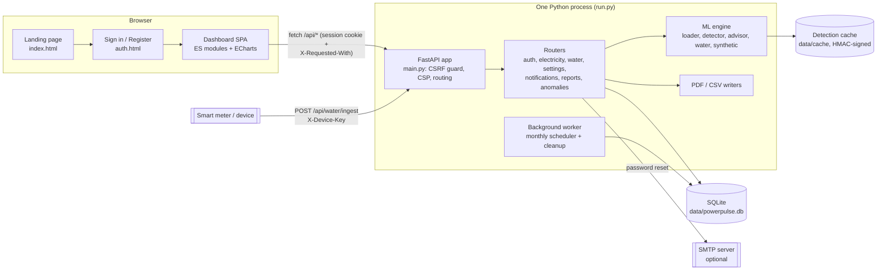

# PowerPulse AI

*Understand Energy. Detect Anomalies. Power Smarter.*

An intelligent household utility monitoring platform that tracks electricity and water consumption, detects unusual usage patterns, estimates costs, and provides actionable savings recommendations.

[](https://github.com/Harshith228/power-pulse-ai/actions/workflows/ci.yml)

- [Problem and objectives](#problem-statement)
- [Features](#features)
- [Technology and architecture](#technology-and-architecture)
- [Installation](#installation)
- [Environment configuration](#environment-configuration)
- [Datasets](#datasets)
- [Notifications and WhatsApp](#notifications-and-whatsapp)
- [Testing and deployment](#testing-and-deployment)
- [Known limitations](#known-limitations)
- [Documentation index](#documentation)

## Problem statement

Households usually learn about wasted electricity or water only when the monthly bill arrives - weeks after a geyser was left on, an AC ran all night or a flush tank started leaking. Meter data exists (smart meters, utility exports, manual readings), but it is raw numbers: nobody tells the household what is *normal* for their home, when something stopped being normal, what it cost, and what to check.

## Objectives

1. Turn raw electricity and water readings into a clear picture of daily, weekly and monthly use.
2. Learn each home's own normal pattern and flag spikes, sustained increases and repeated unusual loads, with a plain-language explanation of *why* each one was flagged.
3. Put a price on usage and on anomalies using the household's own slab tariff, and recommend concrete actions.
4. Let each household set daily limits and get alerts and monthly reports - privately, per account.
5. Be honest about uncertainty: no invented data, no claims about specific appliances or pipes the data can't support.

## Features

| Area | What it does |
|---|---|
| **Electricity analytics** | Hourly use vs a learned baseline, daily profile, weekday/hour heatmap, peaks, insights; daily/weekly/monthly totals by source |
| **Water analytics** | Daily trend, weekday pattern, hourly profile and heatmap (hourly data), weekly/monthly totals, insights - in litres / kL |
| **Manual consumption entry** | Electricity readings (whole-day total or per hour) and water readings, with validation, edit and delete. Imported data is never double counted |
| **CSV dataset uploads** | Electricity: smart-meter / utility exports (auto-detects separator, timestamp and kWh/Wh/kW/W columns, cleans and resamples). Water: native file picker, server-side preview of every row that won't import, then confirm or cancel |
| **AI/ML anomaly detection** | Robust per-hour baseline + Isolation Forest + event rules: spikes, sustained increases, repeated loads, night-time increases; water spikes, sustained rises, overnight use and continuous flow (leak signature). Thresholds are tunable per user |
| **Daily consumption limits** | Per utility, optional per-weekday overrides, configurable warning threshold, limit history |
| **Alerts and notifications** | In-app notification centre with de-duplication; unread anomaly badges that clear only when an anomaly is actually seen |
| **Cost estimation** | Editable INR slab tariff + fixed charge for electricity (kWh) and water (kL); bill history and a what-if simulator |
| **Savings recommendations** | Rule-based recommendations matched to circuit and time of day; avoidable cost of anomalies |
| **Monthly reports** | Electricity, Water or Combined reports for any month or custom range (up to one year), shown on screen, with separate **PDF** and **CSV** downloads; optional automatic report on a chosen day each month (never duplicated) |
| **Authentication** | Register, sign in, sign out, "keep me signed in", password reset (email or server log), change password, active sessions, sign out other sessions, data export, account deletion |
| **Themes** | Light, Dark and System (follows the OS live), applied before first paint |
| **Responsive dashboard** | Collapsible sidebar, mobile drawer; verified at 1920, 1440, 1024, 768, 390 and 360 px |
| **Smart-meter ingest** | Per-device API keys for pushing water readings (`POST /api/water/ingest`) |
| **Validation lab** | Synthetic household with labelled injected anomalies to measure detection quality |

> **WhatsApp:** a WhatsApp notification integration existed in an earlier build and was **removed** from this release at the project owner's request. Notifications are in-app (plus email for password reset). See [docs/WHATSAPP_SETUP.md](docs/WHATSAPP_SETUP.md).

## Technology and architecture

| Layer | Technology (as used in this repository) |
|---|---|
| Backend / API | **Python 3.12+**, **FastAPI** 0.162, **Uvicorn**; serves the API *and* the static frontend on one port |
| ML / data | **pandas**, **NumPy**, **scikit-learn** (Isolation Forest) |
| Database | **SQLite** via the Python standard library (`sqlite3`, WAL mode), versioned migrations with `PRAGMA user_version` |
| Auth & security | Standard library: scrypt password hashing, server-side sessions in HttpOnly SameSite cookies, hashed tokens, rate limiting, CSRF header check, strict Content-Security-Policy |
| Frontend | **Vanilla JavaScript ES modules**, hand-written CSS design system, inlined Lucide icons - **no build step, no bundler, no framework** |
| Charts | **Apache ECharts** (vendored in `frontend/vendor/`, works offline) |
| Reports | Built-in PDF writer (`backend/app/pdf.py`) and CSV export; in-process scheduler |
| Email | Standard library SMTP (optional; password-reset links) |
| Tests | **pytest** + **httpx** (backend), Node.js + Chrome DevTools Protocol (end-to-end, `e2e/run.mjs`) |
| Tooling | ruff, mypy, oxlint, pip-audit, GitHub Actions |



- **Frontend:** three HTML entry points (landing, auth, dashboard). The dashboard is a hash-routed single-page app (`js/app.js`, `js/shell.js`) with one module per view in `js/views/`; `js/store.js` holds state and API calls; `js/charts.js` builds every chart. `js/boot.js` applies the theme before first paint (no inline scripts, so the CSP can forbid them).
- **Backend:** `backend/app/main.py` assembles routers, the CSRF guard, security headers and the worker. Each router module owns one area (see [docs/ARCHITECTURE.md](docs/ARCHITECTURE.md)). Every query is scoped by `user_id`; another user's resource returns 404.
- **Database:** 17 tables, schema version 5; migrations run automatically at startup. See [docs/DATABASE.md](docs/DATABASE.md).
- **ML:** `backend/app/engine/` - cleaning and resampling, robust baseline, Isolation Forest, event rules, explanations, cost and recommendations. See [docs/ML_ANOMALY_DETECTION.md](docs/ML_ANOMALY_DETECTION.md).
- **Integrations:** SMTP (optional), smart-meter ingest with device keys, UCI dataset download script. No third-party cloud APIs.

## Installation

Requirements: **Python 3.12+** (developed on 3.13), **Git**. For the end-to-end tests also **Node.js 22+** and Chrome or Edge.

```bash
# 1. Clone
git clone https://github.com/Harshith228/power-pulse-ai.git
cd power-pulse-ai

# 2. Install dependencies into a virtual environment
python -m venv .venv
.venv/bin/python -m pip install -r requirements.txt          # Windows: .\.venv\Scripts\python -m pip install -r requirements.txt

# 3. Configure (optional for local use)
cp .env.example .env                                          # Windows: copy .env.example .env

# 4. Start - API and frontend together
.venv/bin/python run.py                                       # Windows: .\.venv\Scripts\python run.py
```

Open http://127.0.0.1:8000, choose **Get started** and create an account. The first sign-in loads the public UCI household (included as `data/uci_household_hourly.csv`) so the dashboard isn't empty; add your own data at any time.

- **Database setup and migrations:** nothing to run by hand. On startup the app creates `data/powerpulse.db` (or `POWERPULSE_DB`) and applies any pending migrations inside a transaction. `GET /api/health` reports the schema version.
- **Frontend:** there is no separate frontend server or build - FastAPI serves `frontend/` on the same port.
- **Optional data:** `python scripts/fetch_uci.py` re-downloads and converts the full UCI dataset (~20 MB download); `python scripts/make_samples.py` regenerates the demo upload files in `data/samples/`.

## Environment configuration

All settings are environment variables, optionally loaded from a `.env` file next to `run.py` (real environment variables win). [`.env.example`](.env.example) lists every variable with placeholder values only. Never commit `.env`.

| Variable | Default | Purpose |
|---|---|---|
| `POWERPULSE_APP_URL` | `http://127.0.0.1:8000` | Public URL (password-reset links). `https://` turns on Secure cookies and HSTS |
| `POWERPULSE_DB` | `data/powerpulse.db` | SQLite database file |
| `POWERPULSE_HOST` / `POWERPULSE_PORT` | `127.0.0.1` / `8000` | Listen address |
| `POWERPULSE_SESSION_DAYS` | `7` | Session length (30 days with "keep me signed in") |
| `POWERPULSE_SCHEDULER` | `1` | Background worker (monthly reports + cleanup) |
| `POWERPULSE_SECURE_COOKIES` | from APP_URL | Override the cookie `Secure` flag |
| `POWERPULSE_TRUSTED_PROXIES` | - | Proxy IPs whose `X-Forwarded-For` is trusted |
| `POWERPULSE_LOGIN_LIMIT_PER_IP` / `POWERPULSE_REGISTER_LIMIT_PER_IP` | `100` / `30` | Rate limits |
| `POWERPULSE_HIDE_API_DOCS` | `0` | Hide `/docs` in production |
| `SMTP_HOST`, `SMTP_PORT`, `SMTP_USER`, `SMTP_PASSWORD`, `SMTP_FROM` | - | Optional SMTP for password-reset email; without it reset links go to the server log only |

## Datasets

Full details: [docs/DATASET_DOCUMENTATION.md](docs/DATASET_DOCUMENTATION.md).

- **Electricity sample:** *Individual Household Electric Power Consumption* - Hebrail, G. & Berard, A., UCI Machine Learning Repository, **CC BY 4.0**. One home in Sceaux, France, Dec 2006 - Nov 2010, resampled to hourly kWh with three sub-meter circuits.
- **Electricity CSV:** a timestamp column (`timestamp`, `datetime`, `date`+`time`, ...) and one value column (`kwh`, `wh`, `kw`, `power`, `energy`, ...); optional `circuit_<name>_kwh` columns. Hourly or finer, at least 14 days.
- **Water CSV:** a date/time column (`date`, `timestamp`, ...) and one volume column in litres or kL (e.g. `water_usage_litres`, `water_usage_kl`) - daily or hourly, or cumulative meter readings. Columns can be mapped by hand in the preview.
- **Preprocessing:** negatives, duplicates and impossible values removed; resampled to hourly; gaps of 3 hours or less interpolated, longer gaps dropped; every dropped water row reported by line number.
- **Synthetic data:** `engine/synthetic.py` generates a 75-day Indian household with labelled injected anomalies for validation. It is a test fixture, not a model of any real home.

## Notifications and WhatsApp

Notifications are **in-app** (notification centre and sidebar badges) with a database-enforced `dedupe_key`, so re-uploads, re-evaluation and restarts never repeat an alert. Password-reset links go by email when SMTP is configured, otherwise to the server log.

**WhatsApp integration is not part of this release.** It was removed at the project owner's request; no WhatsApp provider, credentials, templates or webhooks are needed or used. Legacy WhatsApp columns remain in the database schema only so existing databases upgrade without data loss. Details and what re-adding it would require: [docs/WHATSAPP_SETUP.md](docs/WHATSAPP_SETUP.md).

## Testing and deployment

```bash
# Backend: unit + integration tests (temporary database)
cd backend && ../.venv/bin/python -m pytest -q

# Lint and type checks
pip install ruff mypy
ruff check backend
cd backend && mypy app --ignore-missing-imports

# Frontend lint + syntax check (the "production build": there is no bundling step)
npx oxlint@1.90.0 frontend/js e2e
for f in $(find frontend/js e2e -name '*.js' -o -name '*.mjs'); do node --check "$f"; done

# End-to-end: real Chrome, own server on :8765 with a throwaway database
node e2e/run.mjs
```

The E2E runner covers register → sign out → sign in → every page → electricity upload → analytics → water CSV import → limits → notifications → monthly reports (generate, PDF and CSV downloads) → settings → themes, then every page at six screen sizes in light, dark and system themes. Results and screenshots go to `e2e/output/` (git-ignored). See [docs/TESTING.md](docs/TESTING.md).

**Production:** one Python process behind an HTTPS reverse proxy; back up the SQLite file daily. See [docs/DEPLOYMENT.md](docs/DEPLOYMENT.md). Continuous integration runs on every push and pull request ([.github/workflows/ci.yml](.github/workflows/ci.yml)).

## Known limitations

- Electricity detection flags **increases** only (drops such as outages are not flagged) and needs hourly or finer readings with at least 14 days; the first 7 days are baseline warm-up.
- The baseline is hour-of-day × weekday/weekend; it doesn't model holidays or weather, so seasonal shifts are absorbed gradually over the 28-day window.
- Manual (daily) electricity readings support daily spike detection only, after 14 days of history, and can't say which hour or appliance caused a spike.
- Water detection sees the household total only, so it suggests checks and never names a faulty fixture.
- Savings are estimates (80% of anomalous excess assumed avoidable, plus a generic standby reduction). The default tariffs are samples - edit them to match your utility.
- Run **one** server process (rate limits, detection cache and worker are in-process); set `POWERPULSE_SCHEDULER=0` on any extra process.
- Password-reset email needs SMTP; HTTPS needs a reverse proxy. Both are deployment configuration, not included.
- Historical datasets (like UCI 2006-2010) are labelled "latest day in data" instead of "today".

## Documentation

| Document | Contents |
|---|---|
| [docs/ARCHITECTURE.md](docs/ARCHITECTURE.md) | Components, request flow, security model, project layout |
| [docs/DATABASE.md](docs/DATABASE.md) | Tables, constraints, migrations, backups |
| [docs/API_DOCUMENTATION.md](docs/API_DOCUMENTATION.md) | Every HTTP endpoint |
| [docs/ML_ANOMALY_DETECTION.md](docs/ML_ANOMALY_DETECTION.md) | Detection pipeline, rules, severity, validation results |
| [docs/DATASET_DOCUMENTATION.md](docs/DATASET_DOCUMENTATION.md) | Data sources, CSV formats, preprocessing |
| [docs/WHATSAPP_SETUP.md](docs/WHATSAPP_SETUP.md) | Status of the WhatsApp integration (removed) |
| [docs/DEPLOYMENT.md](docs/DEPLOYMENT.md) | Production setup, reverse proxy, backups, troubleshooting |
| [docs/TESTING.md](docs/TESTING.md) | Test suites, CI, what each covers |
| [CONTRIBUTING.md](CONTRIBUTING.md) · [SECURITY.md](SECURITY.md) · [CHANGELOG.md](CHANGELOG.md) | Project process |

## Credits and licenses

- Code: [MIT License](LICENSE).
- Apache ECharts (vendored in `frontend/vendor/echarts.min.js`): Apache License 2.0.
- Lucide icons (inlined SVG paths in `frontend/js/icons.js`): ISC License.
- UCI *Individual Household Electric Power Consumption* dataset (`data/uci_household_hourly.csv` is derived from it): Hebrail, G. & Berard, A., UCI Machine Learning Repository, CC BY 4.0.

Built by team **CodeBlitz** for **TECH Quest 2.0**.
