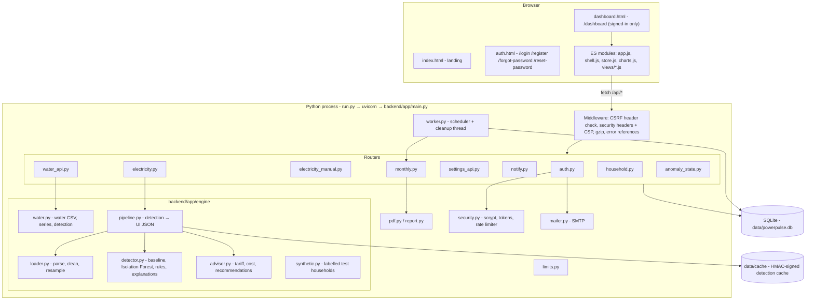

# Architecture

PowerPulse AI is a single Python process. FastAPI serves both the JSON API (`/api/*`) and the static frontend; SQLite stores everything; a background thread in the same process runs the monthly-report scheduler and cleanup. There is no build step, no separate frontend server and no external cloud service.

## Frontend

| Part | Files | Notes |
|---|---|---|
| Entry pages | `frontend/index.html`, `auth.html`, `dashboard.html` | `/dashboard` is served only to signed-in users; `/login` and `/register` redirect signed-in users to the dashboard |
| Boot | `js/boot.js` | Loaded in `<head>`; applies the saved theme before first paint and reloads pages restored from the back/forward cache |
| Shell and routing | `js/app.js`, `js/shell.js` | Hash routes (`#overview`, `#reports`, ...), collapsible sidebar, mobile drawer, header, notification bell, unread anomaly badges |
| State and API | `js/store.js` | All `fetch` calls (with `X-Requested-With: PowerPulse`), cached state |
| Views | `js/views/*.js` | One module per page: household overview, electricity and water analytics / anomalies / alerts / limits / savings / reports, monthly reports, notifications, data, settings, validation lab |
| Charts | `js/charts.js` | Apache ECharts builders with shared motion timings; respects reduced motion |
| Shared UI | `js/ui.js`, `js/components.js`, `js/forms.js`, `js/format.js`, `js/icons.js`, `js/theme.js` | Toasts, modals, count-up, form validation, formatting, inline Lucide icons |
| Feature helpers | `js/elec-manual.js`, `js/water-import.js`, `js/anomaly-read.js`, `js/simulator.js` | Manual electricity entry, water CSV import flow, read tracking, bill simulator |
| Styles | `css/base.css`, `theme-dark.css`, `navigation.css`, `dashboard.css`, `features.css`, `landing.css`, `auth.css` | Design tokens with a separate dark palette |

No framework or bundler is used; the browser loads the ES modules directly.

## Backend

| Module | Responsibility |
|---|---|
| `main.py` | App assembly: routers, CSRF guard, security headers, protected pages, health check, worker lifecycle |
| `config.py` | Settings from environment variables / `.env` |
| `db.py` | SQLite connections (WAL, foreign keys) and numbered migrations |
| `security.py` | scrypt hashing, session / reset tokens, in-memory rate limiter |
| `auth.py` | Register, login, logout, password reset and change, profile, sessions, export, delete account |
| `electricity.py` | Electricity datasets (upload, UCI, synthetic scenario), detection cache, reports, samples, validation |
| `electricity_manual.py` | Manual electricity readings and the combined daily series (imported data wins; no double counting) |
| `water_api.py` | Water readings, CSV preview / import, demo data, summary, anomalies, device keys and ingest |
| `settings_api.py`, `user_settings.py` | Per-user settings, limits, checklists |
| `limits.py` | Daily limit status and violations |
| `notify.py` | Notification creation with de-duplication, evaluation, notification centre API |
| `anomaly_state.py` | Per-user read / unread state of anomalies |
| `monthly.py` | Monthly and custom-range reports, PDF and CSV, scheduler |
| `household.py` | Combined electricity + water summary for the overview |
| `pdf.py`, `report.py` | Minimal PDF writer; anomaly report HTML / CSV |
| `mailer.py` | SMTP email (or server-log fallback) |
| `worker.py` | Background thread: monthly scheduler every 10 minutes, hourly cleanup of expired sessions and reset tokens |

## Request flow

1. The browser sends `fetch('/api/...')` with the session cookie; state-changing requests also send `X-Requested-With: PowerPulse` (requests without it get 403 - CSRF protection, since browsers won't add that header cross-site without CORS).
2. The router resolves the user from the hashed session token; every SQL query filters by `user_id`. Another user's resource returns 404, not 403.
3. Heavy electricity analysis goes through `engine/pipeline.py`; results are cached in memory and in HMAC-signed files under `data/cache/` keyed by data + thresholds.
4. Responses are JSON with `Cache-Control: no-store`. Unexpected errors are logged with a traceback and a short reference code; the user sees only the reference.

## Security model

- Passwords: scrypt with per-user salt. Session and reset tokens: random, stored only as hashes.
- Cookies: HttpOnly, SameSite=Lax, `Secure` when the app URL is `https://`.
- CSRF: custom-header check on every state-changing API call.
- Rate limits on login and registration per client IP (proxy-aware via `POWERPULSE_TRUSTED_PROXIES`).
- Headers: strict Content-Security-Policy (no inline scripts), X-Frame-Options DENY, nosniff, Referrer-Policy, Permissions-Policy, HSTS on HTTPS.
- CSV exports neutralise spreadsheet formulas in text cells.
- Device ingest uses per-device keys stored as hashes.

## Background worker

`worker.py` starts with the app (unless `POWERPULSE_SCHEDULER=0`). Every 10 minutes it generates last month's report for users whose delivery day has passed (`UNIQUE(user_id, period)` prevents duplicates); every hour it removes expired sessions and reset tokens. `GET /api/health` reports whether it is running.
