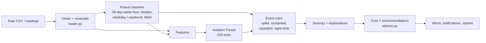

# ML anomaly detection

PowerPulse AI combines a **robust statistical baseline**, an **unsupervised Isolation Forest** and **explainable event rules**. Every flagged event comes with the numbers behind it (actual vs expected, robust z-score, model rarity, hour-to-hour jump, contributing circuit), so a household can see *why* it was flagged. No deep learning and no labelled training data are needed: the model learns each home's own normal pattern.

Code: [`backend/app/engine/`](../backend/app/engine/) - `loader.py` (cleaning), `detector.py` (electricity), `water.py` (water), `advisor.py` (cost and recommendations), `pipeline.py` (output for the UI), `synthetic.py` (validation data).

## Electricity (hourly data)

1. **Cleaning** (`loader.py`) - see [DATASET_DOCUMENTATION.md](DATASET_DOCUMENTATION.md). Output: an hourly kWh series plus optional per-circuit columns. At least 14 days are required; the first 7 days are warm-up for the baseline.
2. **Robust baseline** - expected kWh for each hour = median of the same clock hour over the previous 28 days, computed separately for weekdays and weekends. Spread is the rolling median absolute deviation (MAD), giving a robust z-score that outliers can't inflate.
3. **Isolation Forest** (scikit-learn, `n_estimators=200`, `random_state=42`) over 8 engineered features per hour: consumption level, robust z (clipped ±20), ratio to baseline, hour-to-hour change, 24-hour rolling mean, hour-of-day sine and cosine, weekend flag. Its anomaly score is converted to a percentile *rarity*.
4. **Event rules** (all thresholds are per-user settings, *Settings > Detection*, with enforced bounds):

| Event | Default condition |
|---|---|
| **Spike** | robust z ≥ 4.0 **and** Isolation Forest rarity ≥ 98% **and** excess ≥ max(0.25 kWh, 30% of expected). Consecutive hours merge into one event |
| **Sustained increase** | ≥ 3 days at ≥ 120% of a 4-week daily median lagged by 7 days (so a slow drift can't hide itself), with the whole run averaging ≥ +30%. Days when the home was empty don't count toward the baseline |
| **Repeated** | spikes at the same clock hour on ≥ 3 days, each within 7 days of the previous |
| **Night-time increase** | a night's total (default 22:00-06:00) ≥ 2× the median of the previous 14 nights and ≥ 2 kWh above it. Consecutive nights merge; a sustained rise whose extra energy is mostly at night is reported as night-time |

5. **Severity** - spikes by excess energy measured in "typical hours" of this home's use; sustained by percentage increase and duration; repeated by number of occurrences.
6. **Explanations** - each event lists actual vs expected, z-score, Isolation Forest rarity, the hour-to-hour jump and, when circuit data exists, which circuit caused the excess.
7. **Cost and savings** (`advisor.py`) - an editable INR slab tariff plus fixed charge. Avoidable cost assumes 80% of anomalous excess can be avoided, priced at the marginal slab rate. Rule-based recommendations are matched to circuit and time of day (geyser, AC, pump, standby load, ...).

Changing a threshold re-runs the analysis and updates stored anomalies and alerts. Results are cached (in memory and HMAC-signed files in `data/cache/`) keyed by data + thresholds.

## Electricity (manual daily readings)

When only daily totals exist (manual entry), detection runs on daily totals: a day is a spike when it is ≥ 1.5× **and** ≥ 3.5 robust standard deviations above the median of the previous 4 weeks **and** ≥ 2 kWh higher - only once at least 14 earlier days have data. These events can't identify an hour or appliance and say so.

## Water

`water.py` works on daily totals (and hourly readings when available):

| Rule | Condition |
|---|---|
| Sudden spike | day ≥ 1.5× its 28-day median, robust z ≥ 3.5, and ≥ +50 L |
| Sustained increase | 7-day mean (spikes clipped) ≥ +30% vs a lagged 4-week median, for ≥ 3 days |
| Repeated | ≥ 3 high days within 21 days |
| High overnight use | 00:00-05:00 ≥ 3× the previous 14 nights (hourly data) |
| Continuous flow | every hour of a day had ≥ 2 L (hourly data) - a typical leak signature |

Each event reports actual vs expected, % deviation, severity, possible explanations and recommended checks (taps, flush tanks, tank overflow, pipelines). Because only the household total is measured, it never claims a specific fixture is faulty.

## Alerting

Anomalies become notifications only when they fall within the last 7 days of data and meet the user's minimum severity (default *high*). A unique `dedupe_key` per user prevents duplicates across re-uploads, re-evaluation and restarts.

## Validation

`synthetic.py` generates a 75-day Indian household split into circuits (AC, geyser, kitchen, lighting, always-on, pump) and injects labelled **spike**, **sustained** and **repeated** anomalies, or none (**normal**). Injected hours carry `injected=True`, so the validation lab labels every alert as *Injected* or *Natural*. The same injector also works on the real UCI home.

Results (4 seeds each):

| Scenario | Injected segments found | Alert precision |
|---|---|---|
| Normal household | - (0 alerts on 3 seeds, 1 minor alert on 1) | - |
| Spike / Sustained / Repeated / Mixed, synthetic | 100% | 100% |
| Mixed, injected into the real UCI home | 67-89% | - (22-24 natural events also present) |

The real-home misses are mostly evening spikes: at 20:00 that home's own variation is about ±1.3 kWh, so a planted +4 kWh hour has a z-score of only about 3.

## Limitations

- Detects **increases** only; drops (e.g. outages) are not flagged.
- The baseline models hour-of-day × weekday/weekend, not holidays or weather; seasonal shifts are absorbed gradually over 28 days.
- Synthetic results measure the method on idealised data; real-home recall is lower (above) and there is no labelled real-world ground truth.
- Savings figures are estimates based on stated assumptions, not guarantees.
